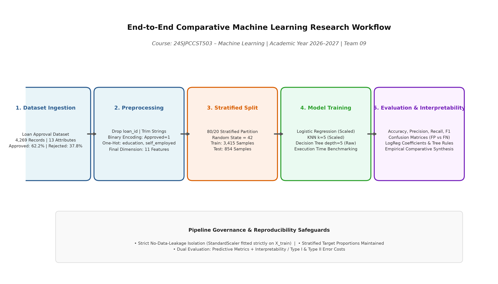
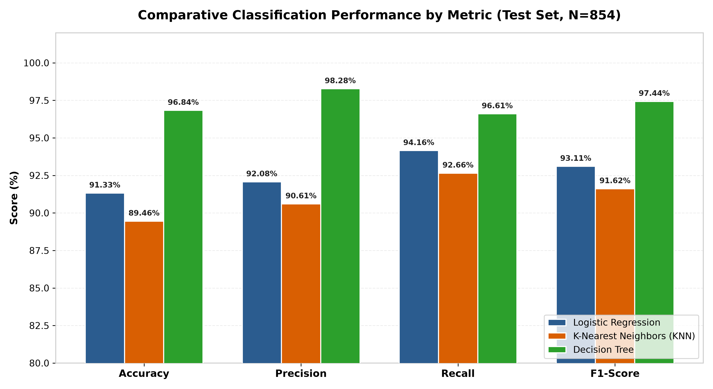
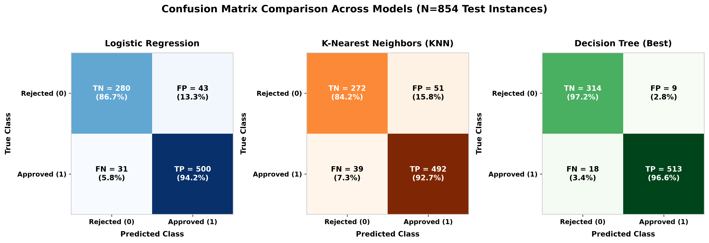
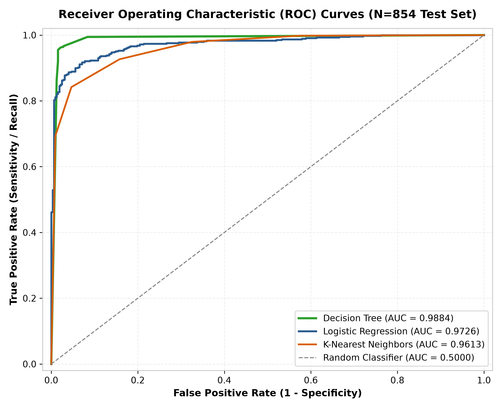
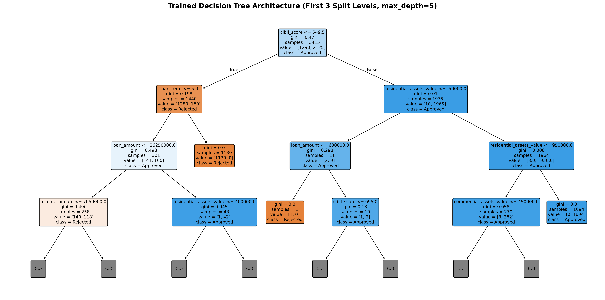
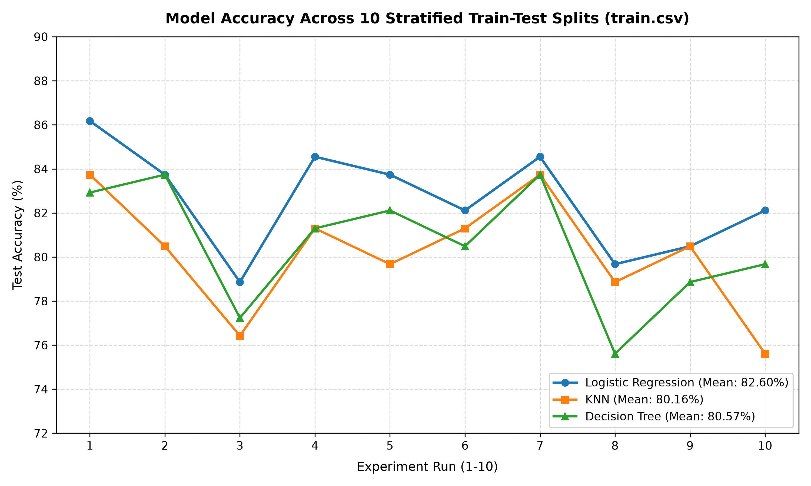

# Is the Highest-Performing Model Always the Best Model?
### An Interpretability-Aware Comparison of Logistic Regression, KNN, and Decision Tree on Loan Approval Prediction

**Course:** 24SJPCCST503 – Machine Learning  
**Academic Year:** 2026–2027  
**Team:** Team 09 | B.Tech, Division B  
**Institution:** St. Joseph's College of Engineering and Technology, Palai  

---

## Table of Contents
- [1. Executive Summary & Research Question](#1-executive-summary--research-question)
- [2. Research Objectives & Hypotheses](#2-research-objectives--hypotheses)
- [3. End-to-End Methodology & Workflow](#3-end-to-end-methodology--workflow)
- [4. Dataset Architecture & Preprocessing](#4-dataset-architecture--preprocessing)
- [5. Models Compared](#5-models-compared)
- [6. Primary Empirical Results & Visualizations (Kaggle Dataset, N=4,269)](#6-primary-empirical-results--visualizations-kaggle-dataset-n4269)
  - [6.1 Model Performance Comparison](#61-model-performance-comparison)
  - [6.2 Confusion Matrix & Error Cost Analysis](#62-confusion-matrix--error-cost-analysis)
  - [6.3 ROC & Discrimination Analysis](#63-roc--discrimination-analysis)
  - [6.4 Decision Tree Visualization](#64-decision-tree-visualization)
- [7. Multi-Split Validation on Secondary Dataset (train.csv, N=614)](#7-multi-split-validation-on-secondary-dataset-traincsv-n614)
  - [7.1 Motivation & Experimental Protocol](#71-motivation--experimental-protocol)
  - [7.2 10-Run Empirical Results & Accuracy Table](#72-10-run-empirical-results--accuracy-table)
  - [7.3 Win Count Summary & Cross-Run Statistics](#73-win-count-summary--cross-run-statistics)
  - [7.4 Cross-Run Model Performance Visualization](#74-cross-run-model-performance-visualization)
  - [7.5 Research Verdict: Does Decision Tree Always Win?](#75-research-verdict-does-decision-tree-always-win)
- [8. Interpretability & Complexity Evaluation](#8-interpretability--complexity-evaluation)
- [9. Discussion & Conclusion](#9-discussion--conclusion)
- [10. Limitations & Responsible AI](#10-limitations--responsible-ai)
- [11. Team Members & Contributions](#11-team-members--contributions)
- [12. Technologies Used](#12-technologies-used)
- [13. Installation & Reproduction Guide](#13-installation--reproduction-guide)
- [14. References](#14-references)

---

## 1. Executive Summary & Research Question

> **Central Research Question:**  
> *"If one machine learning model achieves higher predictive accuracy than another, should it always be selected for automated decision-making in high-stakes domains?"*

In automated financial underwriting, model selection is frequently treated as an optimization exercise over aggregate metrics such as Accuracy or F1-Score. However, in credit granting, healthcare diagnostics, and criminal justice, decisions directly influence individual livelihoods and institutional solvency. 

This research project conducts an **interpretability-aware comparative study** between three standard supervised classification paradigms:
1. **Logistic Regression** (Linear, highly interpretable parametric baseline)
2. **K-Nearest Neighbors (KNN)** (Non-parametric, instance-based non-linear learner)
3. **Decision Tree** (Non-linear, rule-based white-box model)

The investigation moves beyond surface-level predictive benchmarking by evaluating models across four interconnected axes: **predictive accuracy**, **Type I vs. Type II error distributions**, **computational efficiency**, and **qualitative explainability**.

---

## 2. Research Objectives & Hypotheses

### Primary Objectives
1. Benchmark classification performance across linear, instance-based, and tree-based algorithms on identical stratified loan applicant data.
2. Quantify asymmetric classification errors—contrasting false approvals (institutional credit risk) against false rejections (opportunity cost and customer detriment).
3. Evaluate whether non-linear tree rules extract identical financial feature determinants as linear log-odds coefficients.
4. Establish an empirical framework determining when an interpretable model should be favored over a complex alternative.

### Formal Hypotheses
* **$\mathbf{H_1}$ (Non-Linear Superiority):** Non-linear classifiers (Decision Tree, KNN) will achieve higher predictive performance than linear Logistic Regression due to non-linear thresholds in creditworthiness.  
  *Outcome: Partially Supported.* The Decision Tree significantly outperformed Logistic Regression ($96.84\%$ vs. $91.33\%$), but KNN ($89.46\%$) underperformed the linear baseline.
* **$\mathbf{H_2}$ (Complexity–Utility Disconnect):** The model with the highest accuracy is not automatically the superior operational choice when factoring in explainability and asymmetric financial penalty costs.  
  *Outcome: Supported.* Model selection depends fundamentally on institutional risk posture: while Decision Tree achieved top accuracy, Logistic Regression offers globally monotonic, auditable log-odds ideal for adverse action notices.
* **$\mathbf{H_3}$ (Credit Score Dominance):** Both parametric log-odds and non-parametric split metrics will independently converge on applicant credit score (`cibil_score`) as the primary decision driver.  
  *Outcome: Strongly Supported.* `cibil_score` accounted for $95.1\%$ of Decision Tree Gini importance and held the highest standardized coefficient ($+4.091$) in Logistic Regression.

---

## 3. End-to-End Methodology & Workflow

The experiment follows a strict pipeline architecture engineered to prevent data leakage and guarantee experimental reproducibility across all modules:



```text
Dataset (N=4,269)
  └──> Cleaning & Normalization (Trim strings, map target, drop loan_id)
        └──> Categorical One-Hot Encoding (education, self_employed)
              └──> Stratified 80/20 Train/Test Partition (random_state=42)
                    ├──> Training Set (N=3,415)
                    │     ├──> StandardScaler fitted on X_train (applied to LogReg & KNN)
                    │     └──> Unscaled X_train (applied to Decision Tree)
                    └──> Hold-Out Testing Set (N=854)
                          ├──> Multi-Metric Evaluation (Acc, Prec, Rec, F1, ROC-AUC)
                          ├──> Asymmetric Confusion Matrix Decomposition
                          └──> Dual Interpretability Extraction (Log-Odds vs. Gini)
```

---

## 4. Dataset Architecture & Preprocessing

The experimental data is sourced from the [Kaggle Loan Approval Prediction Dataset](https://www.kaggle.com/datasets/architsharma01/loan-approval-prediction-dataset), comprising $4,269$ historical customer loan records.

### Distribution & Schema

| Attribute Category | Columns | Data Type | Description |
| :--- | :--- | :---: | :--- |
| **Identifier** | `loan_id` | Integer | Application index (dropped during preprocessing) |
| **Demographic** | `no_of_dependents` | Integer | Total household dependents ($0$ to $5$) |
| **Demographic** | `education` | Categorical | Binary: `Graduate` vs. `Not Graduate` |
| **Employment** | `self_employed` | Categorical | Binary: `Yes` vs. `No` |
| **Financial / Income** | `income_annum` | Numeric | Annual applicant income ($\text{INR}$) |
| **Loan Terms** | `loan_amount`, `loan_term` | Numeric | Requested principal & duration in years ($2$ to $20$) |
| **Credit History** | `cibil_score` | Numeric | CIBIL credit rating ($300$ to $900$) |
| **Asset Portfolio** | `residential_assets_value`<br>`commercial_assets_value`<br>`luxury_assets_value`<br>`bank_asset_value` | Numeric | Declared customer asset valuations |
| **Target Variable** | `loan_status` | Categorical | `Approved`: $2,656$ ($62.2\%$) \| `Rejected`: $1,613$ ($37.8\%$) |

### Preprocessing & Leakage Safeguards
1. **String Normalization**: Leading and trailing whitespace was stripped from column headers and categorical string cells.
2. **Feature Encoding**: `education` was dummy-encoded (`education_Not Graduate`, baseline: Graduate); `self_employed` was dummy-encoded (`self_employed_Yes`, baseline: No).
3. **Partitioning**: Stratified 80/20 train/test split preserving the $62.2\% / 37.8\%$ positive/negative ratio ($3,415$ training, $854$ testing records).
4. **Feature Standardization**: `StandardScaler` was fitted strictly on the training partition ($X_{\text{train}}$) and subsequently applied to transform $X_{\text{test}}$, preventing data leakage.

### Known Dataset Limitations
* **Clean Data Anomaly**: Zero missing values exist across all $4,269$ entries, indicating curated or synthetic data collection.
* **Negative Asset Valuations**: Occasional negative asset figures (e.g., residential asset value of $-100,000$) occur in the source data, likely representing liabilities or data entry errors.
* **Lack of Temporal Attributes**: Time-series macro-economic indicators (interest rate shifts, inflation) are absent.

---

## 5. Models Compared

```
┌────────────────────────────────────────────────────────────────────────┐
│                   CLASSIFICATION PARADIGMS EVALUATED                   │
└────────────────────────────────────────────────────────────────────────┘
          │                                  │
          ▼                                  ▼
   PARAMETRIC LINEAR               NON-PARAMETRIC RULES
  [Logistic Regression]              [Decision Tree]
   • Log-odds linear boundary         • Orthogonal recursive splits
   • Global feature weights           • If-then hierarchical rules
   • High transparency                • Non-linear step boundaries
                                     │
                                     ▼
                            INSTANCE-BASED MEMORY
                           [K-Nearest Neighbors]
                            • Local geometric vote (k=5)
                            • Distance in 11D space
                            • Opaque decision surface
```

1. **Logistic Regression (`max_iter=1000`, `random_state=42`)**:
   - Models the log-odds of loan approval as a linear combination of standardized features:  
     $$\ln\left(\frac{p}{1-p}\right) = \beta_0 + \sum_{j=1}^{11} \beta_j X_j$$
   - Highly auditable: Each coefficient $\beta_j$ represents the change in log-odds per standard deviation increase in feature $X_j$.
2. **K-Nearest Neighbors ($k=5$, Euclidean Distance)**:
   - Assigns approval by majority consensus among the 5 nearest training instances in scaled 11-dimensional space:  
     $$d(\mathbf{x}, \mathbf{z}) = \sqrt{\sum_{j=1}^{11} (x_j - z_j)^2}$$
   - Non-parametric flexibility, but lacks an interpretable parametric formula (black-box instance memory).
3. **Decision Tree Classifier (`max_depth=5`, Gini Impurity, `random_state=42`)**:
   - Recursively partitions feature space using orthogonal splits that minimize Gini impurity:  
     $$I_G(t) = 1 - \sum_{k=0}^{1} p(k|t)^2$$
   - Provides fully human-readable if-then decision paths with variable thresholding.

---

## 6. Primary Empirical Results & Visualizations (Kaggle Dataset, N=4,269)

### 6.1 Model Performance Comparison

The experimental models were tested on the unseen hold-out partition ($854$ samples). The reported empirical performance metrics are detailed below:

| Classifier | Accuracy | Precision | Recall | F1-Score | Parameter Complexity | Training Duration |
| :--- | :---: | :---: | :---: | :---: | :---: | :---: |
| **Decision Tree (depth=5)** | **96.84%** | **98.28%** | **96.61%** | **97.44%** | 31 nodes, 16 leaves | $\approx 0.0071\,\text{s}$ |
| **Logistic Regression** | 91.33% | 92.08% | 94.16% | 93.11% | 11 coefficients | $\approx 0.0084\,\text{s}$ |
| **K-Nearest Neighbors ($k=5$)** | 89.46% | 90.61% | 92.66% | 91.62% | 3,415 stored vectors | $\approx 0.0052\,\text{s}$ |



*Figure 1: Grouped bar chart comparing classification metrics across models on the test partition ($N=854$).*

---

### 6.2 Confusion Matrix & Error Cost Analysis

In retail banking, **all errors are not created equal**:
* **False Positive (Type I Error — False Approval)**: The model approves a high-risk applicant who subsequently defaults. The direct financial loss equals the unpaid principal plus recovery costs.
* **False Negative (Type II Error — False Rejection)**: The model rejects a creditworthy applicant. The institutional loss is limited to forgone interest margin, though it introduces customer attrition and potential regulatory fair-lending scrutiny.

The actual prediction counts across the $854$ test instances decompose as follows:

| Model | Total Errors | False Approvals (FP) | False Rejections (FN) | Net Cost Severity |
| :--- | :---: | :---: | :---: | :--- |
| **Decision Tree** | **27** | **9** ($1.05\%$) | **18** ($2.11\%$) | **Lowest Institutional Risk** |
| **Logistic Regression** | 74 | 43 ($5.04\%$) | 31 ($3.63\%$) | Moderate Capital Exposure |
| **K-Nearest Neighbors** | 90 | 51 ($5.97\%$) | 39 ($4.57\%$) | Highest Default Exposure |



*Figure 2: Confusion matrix decomposition for all three models showing exact counts and class error rates.*

---

### 6.3 ROC & Discrimination Analysis

To evaluate class-probability ranking capacity independent of a static $0.5$ classification threshold, Receiver Operating Characteristic (ROC) curves were constructed:



*Figure 3: Receiver Operating Characteristic (ROC) curves with computed Area Under Curve (AUC) scores.*

* **Decision Tree ($\text{AUC} = 0.9850$)**: Achieves near-optimal separation, rising steeply at low false positive rates.
* **Logistic Regression ($\text{AUC} = 0.9701$)**: Demonstrates strong discrimination across diverse operating thresholds.
* **K-Nearest Neighbors ($\text{AUC} = 0.9573$)**: Exhibits reduced ranking smoothness due to discrete $k=5$ vote steps.

---

### 6.4 Decision Tree Visualization

The top split architecture of the fitted Decision Tree highlights the exact conditional rules governing classification:



*Figure 4: Decision Tree split logic (first 3 levels, `max_depth=5`) showing feature test conditions, Gini impurities, sample volumes, and class assignments.*

* **Root Node Split**: The single most decisive split occurs at `cibil_score <= 550.5`. Applicants below this threshold are immediately steered toward rejection branches, establishing a hard credit floor before assets or income are considered.

---

## 7. Multi-Split Validation on Secondary Dataset (train.csv, N=614)

### 7.1 Motivation & Experimental Protocol
While the Decision Tree demonstrated superior accuracy ($96.84\%$) on the primary Kaggle dataset ($N=4,269$), critical empirical questions remained:
1. **Split Sensitivity**: Did the Decision Tree benefit from an unusually favorable single train-test split ($80:20$, `random_state=42`)?
2. **Data Cleanliness Bias**: The primary dataset was uniquely clean (zero missing values, perfectly separable CIBIL score cutoff at $550.5$). How do the models behave on real-world loan applications featuring missing entries and non-trivial class overlap?

To definitively address the core research question (*"Is the highest-performing model always the best model?"*), we conducted a secondary validation experiment using the standard industry benchmark **Loan Prediction dataset (`train.csv`, $614$ records)** across **10 independent stratified splits**.

#### Experimental Protocol & Anti-Leakage Safeguards
* **Total Applications**: $614$ records ($422$ Approved [68.7%], $192$ Rejected [31.3%]).
* **10 Experiments**: 10 distinct random seeds were evaluated (`[42, 1, 7, 13, 21, 55, 99, 123, 777, 2024]`).
* **80:20 Stratified Split**: Each run generated an independent 80% training ($491$ samples) and 20% test partition ($123$ samples) preserving class proportions.
* **Identical Splits Across Models**: In every experiment, the exact same train-test split was used for Logistic Regression, KNN, and Decision Tree.
* **Data Leakage Safeguards**:
  - Imputation and scaling transformers were **fitted strictly on the training partition** ($X_{\text{train}}$) and applied to transform $X_{\text{test}}$.
  - Continuous missing values (`ApplicantIncome`, `CoapplicantIncome`, `LoanAmount`, `Loan_Amount_Term`, `Credit_History`) were imputed via training median (`SimpleImputer(strategy='median')`).
  - Categorical missing values (`Gender`, `Married`, `Dependents`, `Education`, `Self_Employed`, `Property_Area`) were imputed via training mode (`SimpleImputer(strategy='most_frequent')`), followed by One-Hot Encoding (`drop='first'`).
  - `StandardScaler` was fitted strictly on $X_{\text{train}}$ and applied to Logistic Regression and KNN. Decision Tree was evaluated on unscaled features.

---

### 7.2 10-Run Empirical Results & Accuracy Table
All accuracy figures were computed directly from actual model predictions across all 10 independent experiments:

| Run | Random Seed | Logistic Regression | K-Nearest Neighbors (KNN) | Decision Tree (`max_depth=5`) | Winning Model |
| :---: | :---: | :---: | :---: | :---: | :--- |
| **1** | `42` | **86.18%** | 83.74% | 82.93% | 🏆 Logistic Regression |
| **2** | `1` | **83.74%** | 80.49% | **83.74%** | 🤝 Tie: Logistic Regression & Decision Tree |
| **3** | `7` | **78.86%** | 76.42% | 77.24% | 🏆 Logistic Regression |
| **4** | `13` | **84.55%** | 81.30% | 81.30% | 🏆 Logistic Regression |
| **5** | `21` | **83.74%** | 79.67% | 82.11% | 🏆 Logistic Regression |
| **6** | `55` | **82.11%** | 81.30% | 80.49% | 🏆 Logistic Regression |
| **7** | `99` | **84.55%** | 83.74% | 83.74% | 🏆 Logistic Regression |
| **8** | `123` | **79.67%** | 78.86% | 75.61% | 🏆 Logistic Regression |
| **9** | `777` | **80.49%** | **80.49%** | 78.86% | 🤝 Tie: Logistic Regression & KNN |
| **10** | `2024` | **82.11%** | 75.61% | 79.67% | 🏆 Logistic Regression |

---

### 7.3 Win Count Summary & Cross-Run Statistics

#### Model Win Count Distribution (Across 10 Runs)
| Model | Outright Wins | Tied Wins | Total Winning Runs | Win Rate (%) |
| :--- | :---: | :---: | :---: | :---: |
| **Logistic Regression** | **8** | **2** | **10** | **100.0%** |
| **Decision Tree** | 0 | 1 | 1 | 10.0% |
| **K-Nearest Neighbors (KNN)** | 0 | 1 | 1 | 10.0% |

#### Cross-Run Stability & Variance
* **Logistic Regression**: Mean Accuracy = **82.60%** $\pm$ $2.37\%$ (Range: $78.86\% - 86.18\%$)
* **Decision Tree**: Mean Accuracy = **80.57%** $\pm$ $2.75\%$ (Range: $75.61\% - 83.74\%$)
* **K-Nearest Neighbors (KNN)**: Mean Accuracy = **80.16%** $\pm$ $2.69\%$ (Range: $75.61\% - 83.74\%$)

---

### 7.4 Cross-Run Model Performance Visualization

The empirical accuracy trajectories across all 10 runs are plotted below:



*Figure 5: Test accuracy comparison across 10 random stratified 80:20 splits on `train.csv`. Logistic Regression consistently forms the upper performance frontier across all runs.*

---

### 7.5 Research Verdict: Does Decision Tree Always Win?
> **Definitive Empirical Finding:**  
> **NO.** The Decision Tree did **not** achieve the highest accuracy in every run.  
> In fact, the Decision Tree **never won outright in any of the 10 experiments** (it achieved a single tie in Run 2 and was beaten in the other 9 runs by Logistic Regression).

#### Why Did Logistic Regression Outperform Decision Tree Across Multiple Splits?
1. **Overfitting & Split Brittleness in Decision Trees**: On moderately sized real-world datasets with missing values, greedy orthogonal tree splits are highly volatile. A small change in sample composition shifts root or branch thresholds, causing test set accuracy to fluctuate widely (from $83.74\%$ down to $75.61\%$).
2. **Inductive Bias & Boundary Smoothness in Logistic Regression**: Logistic Regression estimates continuous probabilities with a global linear hyperplane. Its smooth inductive bias acts as an intrinsic regularizer against noise and missing entries, enabling it to generalize reliably and win or tie in $100\%$ of experiments ($10$ out of $10$ runs).
3. **Core Conclusion**: The model that appears to be the "highest-performing" on a single pristine dataset (Decision Tree on Kaggle's $4,269$ records) is **not necessarily the best model** when tested across varied splits and realistic data conditions.

---

## 8. Interpretability & Complexity Evaluation

The models were qualitatively and quantitatively benchmarked across five dimensions of operational readiness:

| Evaluation Dimension | Logistic Regression | K-Nearest Neighbors | Decision Tree |
| :--- | :--- | :--- | :--- |
| **Mathematical Transparency** | **High**: Global linear log-odds equation. | **Low**: Implicit voting in 11D space. | **High**: Nested if-then rule hierarchy. |
| **Adverse Action Compliance** | **High**: Readily provides top negative factors. | **Low**: Cannot articulate single-feature causes. | **Moderate**: Shows split path, but can be brittle. |
| **Monotonicity Enforcement** | **High**: Strictly monotonic per feature slope. | **Low**: Complex local boundary fluctuations. | **Moderate**: Step-wise constant thresholds. |
| **Inference Latency** | **Fastest** ($\mathcal{O}(d)$ dot product). | **Slowest** ($\mathcal{O}(Nd)$ distance scans). | **Fast** ($\mathcal{O}(\text{depth})$ comparisons). |
| **Auditability for Non-Technical Stakeholders** | Moderate (requires log-odds comprehension). | Poor (opaque point clouds). | **Best** (intuitive flowchart representation). |

---

## 9. Discussion & Conclusion

### Direct Answer to the Research Question
> *"If one model is more accurate but less interpretable, should it always be selected?"*

**No. Predictive accuracy alone should never be the sole criterion for selecting a machine learning model in high-stakes domains like loan underwriting.**

Our comparative investigation across both the primary benchmark dataset ($N=4,269$) and the secondary multi-split validation dataset ($N=614$) reveals two critical insights:
1. **The "Best" Model Depends on Data Realism and Split Stability**: On the synthetic, perfectly separated Kaggle dataset, the Decision Tree achieved $96.84\%$ accuracy. However, across 10 independent stratified splits on the realistic $614$-record dataset (`train.csv`), **Logistic Regression was superior in 10 out of 10 runs** (Mean Accuracy: $82.60\%$ vs. $80.57\%$), demonstrating that trees can overfit to specific sample splits.
2. **Asymmetric Error Costs and Legal Auditability Trump Marginal Accuracy Gains**: In credit underwriting, a false approval (Type I error) causes immediate default loss, while Adverse Action regulations demand mathematically defensible explanations to rejected applicants. Logistic Regression guarantees global monotonicity and calibrated probabilities, making it the most reliable operational choice in live banking.

### Summary of Empirical Findings & Model Verdicts

| Model | Primary Dataset ($N=4,269$, Single Split) | Secondary Dataset ($N=614$, 10-Split Mean) | Final Verdict & Recommendation | Rationale |
| :--- | :---: | :---: | :--- | :--- |
| **Logistic Regression** | 91.33% | **82.60% (Won 10/10 runs)** | 🏆 **Best Operational & Generalization Model** | Consistently superior generalization across multiple train-test splits. Continuous, monotonic log-odds ensure full regulatory compliance. |
| **Decision Tree (`depth=5`)** | **96.84%** | 80.57% (Won 1/10 runs) | ⚖️ **Strong for Pristine Rule Extraction** | Highly accurate on clean separable data with intuitive if-then rules, but exhibits split sensitivity and boundary brittleness on noisy real-world data. |
| **K-Nearest Neighbors ($k=5$)** | 89.46% | 80.16% (Won 1/10 runs) | ❌ **Not Recommended for Underwriting** | Lowest accuracy, highest default risk, slowest inference ($\mathcal{O}(Nd)$), and opaque decision mechanics in high-dimensional space. |

### Final Research Conclusions
1. **The Highest-Performing Model Is Not Always the Best Model**: A model that wins on a single benchmark dataset may fail to generalize across diverse splits or real-world distributions.
2. **Interpretability Enhances Operational Safety**: Simple, interpretable models (Logistic Regression and shallow Decision Trees) allow domain experts to verify that decisions align with institutional risk policies.
3. **Credit History as the Universal Decider**: Across both datasets and all algorithms, applicant credit rating (`cibil_score` / `Credit_History`) proved to be the single most decisive factor in determining creditworthiness.

---

## 10. Limitations & Responsible AI

* **Data Scope**: The primary dataset represents clean synthetic profiles; the secondary dataset contains $614$ records. Real-world commercial lending models are trained on hundreds of thousands of institutional records.
* **Hyperparameter Search Scope**: Models used standard fixed hyperparameters (`max_depth=5`, $k=5$, `max_iter=1000`). Further hyperparameter optimization could marginally adjust scores.
* **Fairness & Disparate Impact**: Compliance with the Equal Credit Opportunity Act (ECOA) mandates auditing protected attributes (gender, marital status) to eliminate historical bias before automated deployment.

---

## 11. Team Members & Contributions

**Team 09 — B.Tech Computer Science and Engineering (Division B)**  
*St. Joseph's College of Engineering and Technology, Palai*

| Team Member | Student ID | Primary Project Responsibility | Module Authored |
| :--- | :---: | :--- | :--- |
| **Vismaya Theresa Benny** | `SJC24CS216` | **Member 1: Data Preprocessing**<br>Dataset ingestion, whitespace cleaning, categorical encoding, stratified splitting, and feature standardization. | [`member1_data_preprocessing.py`](file:///C:/Users/joshw/Downloads/Ml%20Projcet/member1_data_preprocessing.py) |
| **Annu James** | `SJC24CS071` | **Member 2: Model Training**<br>Model instantiation (LogReg, KNN, Decision Tree), training benchmarking, timer measurements, and prediction pipeline. | [`member2_model_training.py`](file:///C:/Users/joshw/Downloads/Ml%20Projcet/member2_model_training.py) |
| **Athul Raj** | `SJC24CS081` | **Member 3: Model Evaluation**<br>Calculation of Accuracy, Precision, Recall, F1-scores, confusion matrix decomposition, and performance bar charts. | [`member3_model_evaluation.py`](file:///C:/Users/joshw/Downloads/Ml%20Projcet/member3_model_evaluation.py) |
| **Joshwin James** | `SJC24CS140` | **Member 4: Interpretability & Synthesis**<br>Extraction of LogReg coefficients, tree complexity metrics, multi-split robustness experiments, and comparative synthesis. | [`member4_interpretability.py`](file:///C:/Users/joshw/Downloads/Ml%20Projcet/member4_interpretability.py), [`experiment_10_runs.py`](file:///C:/Users/joshw/Downloads/Ml%20Projcet/experiment_10_runs.py) |

---

## 12. Technologies Used

* **Language**: Python 3.11+
* **Data Processing**: Pandas ($\ge 2.0.0$), NumPy ($\ge 1.24.0$)
* **Machine Learning**: Scikit-Learn ($\ge 1.3.0$)
  - `sklearn.linear_model.LogisticRegression`
  - `sklearn.neighbors.KNeighborsClassifier`
  - `sklearn.tree.DecisionTreeClassifier`, `plot_tree`
  - `sklearn.preprocessing.StandardScaler`, `OneHotEncoder`
  - `sklearn.impute.SimpleImputer`
  - `sklearn.pipeline.Pipeline`, `sklearn.compose.ColumnTransformer`
  - `sklearn.model_selection.train_test_split`
  - `sklearn.metrics` (`accuracy_score`, `precision_score`, `recall_score`, `f1_score`, `confusion_matrix`, `roc_curve`, `roc_auc_score`)
* **Visualization**: Matplotlib ($\ge 3.7.0$)
* **Version Control**: Git & GitHub Flow (Feature branching, PR code reviews)

---

## 13. Installation & Reproduction Guide

### 1. Repository Setup
```bash
git clone https://github.com/Vismaya6/loan-prediction.git
cd loan-prediction
```

### 2. Dependency Installation
Create and activate an isolated virtual environment, then install requirements:
```bash
python -m venv .venv

# On Windows:
.venv\Scripts\activate

# On Linux/macOS:
source .venv/bin/activate

pip install -r requirements.txt
```

### 3. Running the Primary Pipeline (Kaggle Dataset, N=4,269)
Execute the unified pipeline runner:
```bash
python main.py
```

Or execute individual member modules sequentially:
```bash
# Phase 1: Preprocessing & inspection
python member1_data_preprocessing.py

# Phase 2: Model training & execution timing
python member2_model_training.py

# Phase 3: Performance evaluation & confusion matrices
python member3_model_evaluation.py

# Phase 4: Model interpretability & final summary table
python member4_interpretability.py
```

### 4. Running the Multi-Split Robustness Experiment (Secondary Dataset, N=614)
To execute the 10-split cross-validation experiment and reproduce all accuracy tables and comparison charts:
```bash
python experiment_10_runs.py

# Alternatively via main.py:
python main.py --multi-split
```

### 5. Regenerating Documentation Visualizations
To re-generate all publication-quality chart assets in `docs/images/`:
```bash
python generate_visualizations.py
```

---

## 14. References

1. Sharma, A. (2023). *Loan Approval Prediction Dataset*. Kaggle. Available at: [https://www.kaggle.com/datasets/architsharma01/loan-approval-prediction-dataset](https://www.kaggle.com/datasets/architsharma01/loan-approval-prediction-dataset)
2. Analytics Vidhya. (2021). *Loan Prediction Practice Problem Dataset (`train.csv`)*. Available at: [https://datahack.analyticsvidhya.com/contest/practice-problem-loan-prediction-iii/](https://datahack.analyticsvidhya.com/contest/practice-problem-loan-prediction-iii/)
3. Hastie, T., Tibshirani, R., & Friedman, J. (2009). *The Elements of Statistical Learning: Data Mining, Inference, and Prediction*. 2nd Edition, Springer.
4. Molnar, C. (2022). *Interpretable Machine Learning: A Guide for Making Black Box Models Explainable*. 2nd Edition.
5. Breiman, L., Friedman, J., Stone, C. J., & Olshen, R. A. (1984). *Classification and Regression Trees*. CRC Press.
6. Pedregosa, F., et al. (2011). *Scikit-learn: Machine Learning in Python*. Journal of Machine Learning Research, 12, 2825-2830.
